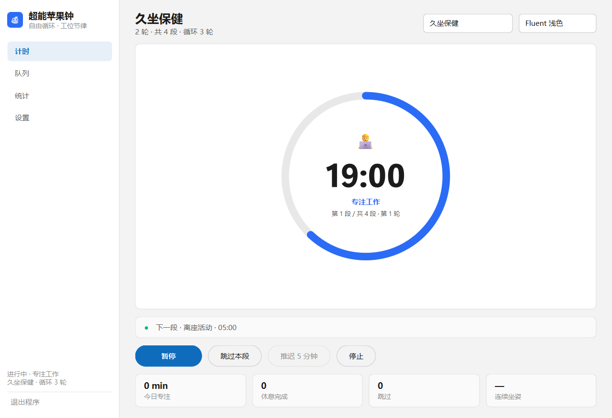
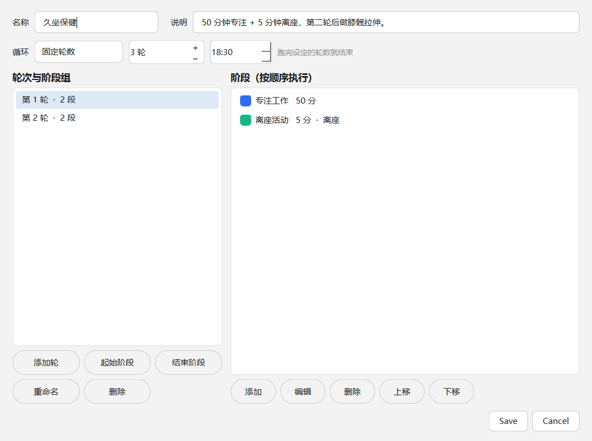

# 超能苹果钟 · 工位节律闹钟

给久坐上班族的**队列式工作闹钟**：把「专注 → 起身 → 专注 → 拉伸」编排成一轮循环，
到点按阶段色、图标、铃声提醒，支持卡点收工、久坐计时、动作库和统计。



## 特性

- **三段队列**：起始阶段 → 各轮循环 → 结束阶段，前后两段可关
- **卡点循环**：固定轮数 / 无限 / 循环到某个时刻（如 18:30 自动收工）
- **阶段属性**：时长（固定或区间随机）、颜色、图标、铃声、提示文案、动作清单、
  是否需离座、可否跳过、提前 N~M 秒软预告
- **渐进式提醒**：角落气泡 → 屏中卡片 →（可选）全屏；声音循环到确认为止
- **久坐健康**：连续坐姿计时、离座确认、19 个内置动作（自绘 SVG 简笔画）、
  饮水与 20-20-20 护眼提醒
- **自动化**：工作时段计划、空闲检测、会议模式全局热键、勿扰时段、开机自启、单实例
- **外部钩子**：每个阶段开始/结束可打开链接、打开文件、运行程序
- **主题**：4 套内置主题（`themes/*.json`），强调色可在界面里单独覆盖



## 环境

- Windows（其他平台未测试）
- Python 3.10+
- PySide6 ≥ 6.6

```bash
python -m venv .venv
.venv\Scripts\activate        # Windows
pip install -r requirements.txt
```

## 运行

```bash
python CirClock.pyw     # 无控制台（Windows，推荐双击）
python -m cirtimer      # 带控制台，方便看日志
```

### Windows 免安装版

`dist/CirClock-win64.zip` 解压后双击 `CirClock.exe`，不需要装 Python。
首次运行会在 exe 旁边生成 `data/`（配置与历史）。

### 从源码构建 exe

```bash
pip install pyinstaller
python tools/build_exe.py      # 产出 dist/CirClock-win64.zip
```

## 平台支持

| 平台 | 状态 | 说明 |
|---|---|---|
| Windows | ✅ 测试过 | 全部功能（含全局热键、空闲检测、开机自启） |
| Linux | ⚠️ 代码已适配，未实机验证 | 链接/文件走 `xdg-open`；开机自启写 `~/.config/autostart`；**全局热键与空闲检测暂不可用** |
| macOS | ⚠️ 理论可用 | 链接走 `open`；开机自启未实现 |

打包脚本 `tools/build_exe.py` 只产出 Windows 版本：PyInstaller 不能跨平台编译，
Linux 需要在 Linux 上跑一遍同样的命令。

首次启动会在 `data/`（或 `%APPDATA%\CirClock`）生成 `config.json` 和 `history.db`。
项目根目录放一个 `portable.marker` 文件即可强制便携模式（配置存在项目内）。

## 退出

窗口右上角 × 会缩到托盘继续计时。退出方式：

- 侧栏左下角「退出程序」，或 `Ctrl+Q`
- 托盘图标右键 → 退出
- 双击 `退出.cmd`
- 命令行 `python CirClock.pyw --quit`

## 测试

```bash
python -m unittest discover -s tests -v
```

## 目录

```
CirClock.pyw          入口（无控制台）
cirtimer/
  config.py           配置模型 + JSON 读写 + 预设队列
  engine.py           队列/计时状态机（起始 → 循环 → 结束）
  actions.py          动作库（19 个动作）
  assoc.py            读注册表解析系统默认应用
  presence.py         空闲检测        sitting.py   连续坐姿计时
  hotkey.py           全局热键 + 时段/勿扰
  hooks.py            外部动作（链接/文件/程序）+ 执行日志
  audio.py            铃声播放        stats.py     SQLite 与统计
  autostart.py        HKCU Run 开机自启
  instance.py         第二实例命令通道（show / quit）
  ui/                 主窗口、页面、编辑器、提醒窗、HUD、托盘
themes/               主题包 JSON
assets/               合成铃声、动作 SVG、应用图标
tools/                资源生成脚本（图标 / 铃声 / 动作图）
docs/                 设计说明与截图
tests/                单元测试
```

## 说明

- 铃声、动作图示、应用图标都是脚本生成的（`tools/gen_*.py`），无版权问题
- 外部链接/文件走系统默认程序（`os.startfile`），和双击行为一致
- 不做医疗建议：动作库只是活动提示，按自身情况调整

## License

MIT
